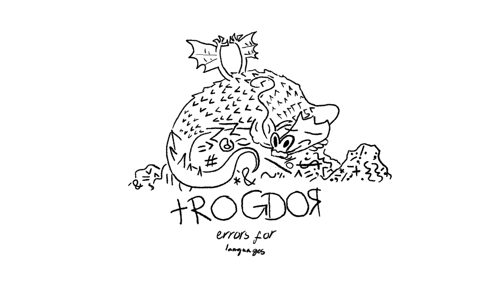

<p align="center"></p>

Trogdor is a crate for tracking and displaying errors inside a programming language.
It supports sources, multiple errors/warnings, and help text.

# Example

```rust
use trogdor::{ErrorHandler, Span};
// Create an error handler to store errors.
let mut eh = ErrorHandler::new();
let source = eh.add_source("<test>", "1 + 2 *");
// Do some kind of parsing...
eh.err("unexpected multiplication sign", Span::new(6..7, source))
    .help_generic("try adding a number after it")
    .help("the file ends here", Span::new(7..8, source));
eh.warn_generic("no configuration specified");
// Print all errors & warnings to stderr
eprintln!("{eh}");
```

More complicated examples can be found in the `examples/` directory.
